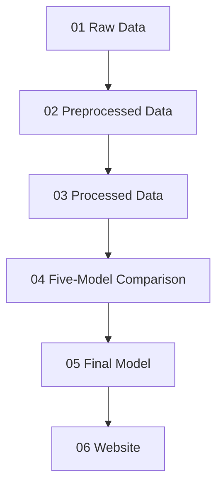

# 🪐 Exoplanet Habitability Classifier

A machine learning pipeline and web app that predicts whether an exoplanet is **habitable** or **non-habitable** from planetary and stellar features.

| | |
|---|---|
| **Domain** | Machine Learning + Astronomy |
| **Task** | Supervised binary classification |
| **Input** | 18 attributes (16 numerical, 2 categorical) |
| **Output** | `1` = Habitable, `0` = Non-habitable |
| **Models** | Logistic Regression, SVM, Decision Tree, Random Forest, XGBoost |
| **Selected model** | XGBoost |
| **Dataset** | Planetary Habitability Laboratory catalog (PHL-ECW) |

## Workflow



## Project Structure

```text
Exoplanet/
├── 01_RAW_DATA/                 original catalog + README
├── 02_PREPROCESSED_DATA/        cleaned dataset, reports, feature selection
├── 03_PROCESSED_DATA/           train/test splits and metadata
├── 04_FIVE_MODEL_COMPARISON/    metrics, confusion matrices, comparison plot
├── 05_FINAL_MODEL/              final_model.joblib + report and plots
├── 06_WEBSITE/
│   ├── backend/                 FastAPI app (app.py, document_analyzer.py)
│   └── frontend/                index.html, css/, js/, assets/
├── src/
│   ├── data_loader.py
│   ├── preprocessing.py
│   ├── dataset_split.py
│   ├── train_and_compare_5_models.py
│   └── predict.py
├── scratch/                     test scripts and sample files
├── app.py
├── requirements.txt
└── README.md
```

## Pipeline Stages

### 1. Raw Data (`01_RAW_DATA/`)
The original, unmodified exoplanet catalog from the Planetary Habitability Laboratory.

- 3,875 confirmed exoplanet records
- 69 astronomical attributes

### 2. Preprocessed Data (`02_PREPROCESSED_DATA/`)
Cleaning, feature audit, and sanitation:

- Coerce string-typed numeric columns (e.g. `P. SFlux Mean`)
- Handle missing values
- Remove physically impossible values (mass ≤ 0, density ≤ 0, Teff < 100 K)
- Remove 12 catalog identifiers and non-predictive metadata
- Remove 18 data-leakage columns (e.g. `P. ESI`, `P. HZD`, `P. Habitable Class`)
- Select 18 scientifically valid features (16 numerical, 2 categorical)
- Standardize spectral types and discovery methods

### 3. Processed Data (`03_PROCESSED_DATA/`)
Model-ready partitions:

- **80% train** (3,100 rows) / **20% test** (775 rows)
- Stratified split (`stratify=y`, `random_state=42`) so class ratios match in both sets

### 4. Five-Model Comparison (`04_FIVE_MODEL_COMPARISON/`)
Five classifiers benchmarked with Stratified 5-Fold Cross-Validation and a held-out test set.

| Model | Accuracy | Precision | Recall | F1-score |
|---|---|---|---|---|
| Logistic Regression | 0.9626 | 0.2750 | 1.0000 | 0.4314 |
| Support Vector Machine | 0.9613 | 0.2683 | 1.0000 | 0.4231 |
| Decision Tree | 0.9987 | 0.9167 | 1.0000 | 0.9565 |
| Random Forest | 0.9974 | 0.8462 | 1.0000 | 0.9167 |
| **XGBoost** | **1.0000** | **1.0000** | **1.0000** | **1.0000** |

**Cross-validation leader:** XGBoost, with the highest PR-AUC (0.9737) and F1-score (0.9305).

### 5. Final Model (`05_FINAL_MODEL/`)
The selected XGBoost pipeline:

- `final_model.joblib`: scikit-learn pipeline (median imputer + one-hot encoder + XGBoost)
- `final_model_name.txt`: name of the selected model
- `final_model_report.json`: performance metrics
- `final_confusion_matrix.png`: confusion matrix on the test set

### 6. Website (`06_WEBSITE/`)
- **Frontend:** interactive UI with real exoplanet presets (Earth analog, TRAPPIST-1 g, Kepler-1638 b, Kepler-221 b, HIP 78530 b), custom sliders, model comparison charts, and a metrics dashboard.
- **Backend:** FastAPI app with these endpoints:

| Endpoint | Purpose |
|---|---|
| `/api/predict` | Run a prediction |
| `/api/metrics` | Model metrics |
| `/api/presets` | Planet presets |
| `/api/validation` | Validation telemetry |

## Getting Started

```bash
# 1. Install dependencies
pip install -r requirements.txt

# 2. Preprocess and split the data
python src/dataset_split.py

# 3. Train and compare the five models
python src/train_and_compare_5_models.py

# 4. Run a demo prediction
python src/predict.py

# 5. Launch the web app (run from the project root folder)
python 06_WEBSITE/backend/app.py
```

Then open <http://127.0.0.1:8000> in your browser.

> **Note:** This is a **local server**. It runs on your own computer while the command is active, so the link only works for you. Press `Ctrl + C` in the terminal to stop it.

## Tech Stack

Python · scikit-learn · XGBoost · FastAPI · HTML / CSS / JavaScript
